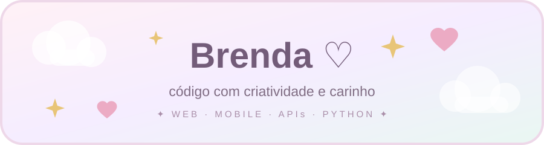
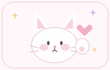
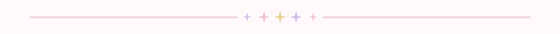

<!-- Perfil de Brendaa090 | tema pastel/kawaii -->

  

   

  

  <h1>Oi, eu sou a Brenda! ♡</h1>

  

    Gosto de transformar ideias em projetos e aprender criando. 
    Por aqui você encontra experimentos em <strong>web, mobile, APIs e Python</strong>.
  

  

 

  

## ✿ Um pouquinho sobre mim

- 💻 Crio projetos para praticar diferentes áreas do desenvolvimento.
- 🌷 Tenho trabalhos com **Node.js, Python, TypeScript, HTML e JavaScript**.
- 🧩 Gosto de explorar soluções que sejam úteis e agradáveis de usar.
- 📚 Este perfil reúne meus projetos e minha evolução como dev.
- 🐈 Entre um commit e outro, sempre cabe um gato.

## ♡ Tecnologias que aparecem por aqui

  
  
  
  
  
  
  

## ✨ Projetos em destaque

| Projeto | O que você vai encontrar |
| :--- | :--- |
| [🧁 API de pedidos](https://github.com/Brendaa090/api-pedidos-jitterbit) | API de pedidos desenvolvida com Node.js, Express e SQLite para um desafio técnico. |
| [📱 Catálogo mobile](https://github.com/Brendaa090/mobile_catalogo) | Projeto mobile com React Native, Expo e TypeScript. |
| [🧸 Agenda escolar](https://github.com/Brendaa090/agenda-escolar) | Projeto integrador de agenda escolar infantil. |
| [🌤️ Captador de temperatura](https://github.com/Brendaa090/Captador-temperatura-portifolio) | Projeto em Python sobre temperaturas de São Paulo e outras cidades. |

  

  
<strong>Obrigada pela visita! ♡</strong>

  <a href="https://github.com/Brendaa090">Voltar ao meu perfil</a>

